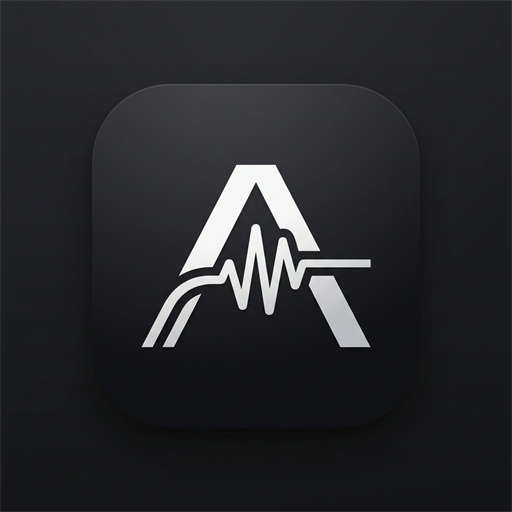

<div align="center">
  

  # Abbadon

  **A fast, modern desktop client for SoundCloud.**  
  *P2P synchronized listening • Live karaoke lyrics • 10-band equalizer • Global media keys*

  <p>
    
    
    
    
    
    
    
  </p>

  <p>
    <a href="https://github.com/Xertoo/Abbadon/releases/latest">
      
    </a>
    <a href="https://buycoffee.to/skcs" target="_blank">
      
    </a>
  </p>

  <p>
    <a href="#-download">Download</a> •
    <a href="#key-features">Key Features</a> •
    <a href="#quick-start">Quick Start</a> •
    <a href="#keyboard-shortcuts">Shortcuts</a> •
    <a href="#tech-stack">Tech Stack</a> •
    <a href="#-support-the-project">Support</a>
  </p>
</div>

---

## 📥 Download

Prebuilt releases are available for Windows and Linux on the [Releases page](https://github.com/Xertoo/Abbadon/releases/latest):

### 🪟 Windows

| Package | Description |
| --- | --- |
| **Windows Installer (`.exe`)** | Standard setup wizard with desktop/start-menu shortcuts and silent background updates. |
| **Portable Edition (`.exe`)** | Standalone executable. No installation required. |

> 💡 **First-time launch note:** If Windows SmartScreen displays *"Windows protected your PC"*, simply click **More info** → **Run anyway**.

---

### 🐧 Linux (Arch, Debian / Ubuntu, Fedora, Universal)

#### ⚡ Quick Install (Universal One-Liner):
Automatically detects your Linux distribution (Arch, Debian, Ubuntu, Fedora), installs system dependencies, downloads the latest release, and sets up desktop shortcuts:
```bash
curl -fsSL https://raw.githubusercontent.com/Xertoo/Abbadon/main/scripts/install-linux.sh | bash
```

---

#### Manual Installation Options:

| Distribution / Format | Package Type | Installation Command |
| --- | --- | --- |
| **Arch Linux (AUR)** | AUR helper (`yay` / `paru`) | `yay -S abbadon-bin` *(or `paru -S abbadon-bin`)* |
| **Arch Linux (PKGBUILD)** | `packaging/arch/PKGBUILD` | `cd packaging/arch && makepkg -si` |
| **Debian / Ubuntu / Mint** | `.deb` package | `sudo apt install ./abbadon_*.deb` *(or `sudo dpkg -i`)* |
| **Fedora / RHEL / openSUSE** | `.rpm` package | `sudo dnf install ./abbadon-*.rpm` |
| **Universal Linux** | `.AppImage` | `chmod +x Abbadon-*.AppImage && ./Abbadon-*.AppImage` |
| **Portable Archive** | `.tar.gz` | `tar -xzf abbadon-*.tar.gz && ./abbadon` |

> 📦 **Linux Dependencies:** Abbadon requires standard audio and UI libraries (`alsa-lib` / `libasound2`, `libnotify`, `nss`, `libxtst`). The stream resolver also integrates automatically with `yt-dlp` (bundled or system-installed).

---

## Overview

SoundCloud's browser player is convenient, but it lives inside a browser tab: accidental tab closures, high memory overhead, zero global media keys, and no simple way to listen in sync with friends without setting up screen shares or Discord bots.

**Abbadon** wraps the full SoundCloud experience into a dedicated desktop application with zero browser clutter, native OS integrations, synchronized peer-to-peer playback, live scrolling lyrics, and precision audio controls.

---

## Key Features

### 🎧 Listen Together (Real-Time P2P Sync)
- **Friend Codes:** Connect with friends via short, unique tags (e.g. `SC-98F2`).
- **Live Presence:** See what friends are streaming in real-time, complete with live progress bars.
- **Direct Playback Sync:** Follow a friend’s stream with sub-second synchronization over direct WebRTC DataChannels.
- **Jam Rooms:** Host a room as a DJ or join existing sessions. Includes real-time chat and emoji reactions.

### 🎤 Synchronized Lyrics (Karaoke Mode)
- Fullscreen view with real-time synchronized scrolling lyrics fetched automatically from LRCLIB.
- Jump directly to any moment in the song by clicking on any lyric line.
- Automatic fallback for instrumental tracks and plain text lyrics.

### 🎚️ 10-Band Parametric Equalizer & Visualizer
- Hardware-accelerated audio processing powered directly by the Web Audio API (`BiquadFilterNode` & `AnalyserNode`).
- Includes built-in acoustic presets (Bass Boost, Vocal, Electronic, Rock, Flat) with support for saving custom user presets.
- Real-time responsive 60 FPS spectrum visualizer.

### 🔄 Spotify Playlist Converter
- Import public Spotify playlists and automatically resolve track metadata to matching SoundCloud audio streams.

### ⌨️ Native OS Integration
- Full support for global multimedia keyboard keys (`Play`, `Pause`, `Next`, `Previous`) that work even when Abbadon is minimized or in the background.
- Clean frameless window design with native minimize, maximize, and exit controls.

---

## Quick Start

### Running from Source

#### Prerequisites
- [Node.js](https://nodejs.org/) (v18 or higher)
- Windows 10 / 11 or Linux (Arch, Debian/Ubuntu, Fedora, openSUSE, etc.)

```bash
# 1. Clone the repository
git clone https://github.com/Xertoo/abbadon.git
cd abbadon

# 2. Install dependencies
npm install

# 3. Launch the desktop application
npm run app
```

*(On Windows, you can also double-click `run.bat` in the project root).*

---

## Development & Packaging Scripts

| Command | Action |
| --- | --- |
| `npm run app` | Builds frontend assets and launches the Electron application |
| `npm run dev` | Starts Vite dev server (for fast frontend UI iterations) |
| `npm run build` | Runs TypeScript checks (`tsc`) and bundles production assets with Vite |
| `npm run dist` | Builds distribution packages for the current host operating system |
| `npm run dist:win` | Builds Windows packages (NSIS installer `.exe` & portable `.exe`) |
| `npm run dist:linux` | Builds all Linux packages (AppImage, deb, pacman, rpm, tar.gz) |
| `npm run dist:deb` | Builds Debian/Ubuntu `.deb` package |
| `npm run dist:pacman` | Builds Arch Linux `.pacman` package |
| `npm run dist:appimage` | Builds universal Linux `.AppImage` |
| `npm run dist:rpm` | Builds RedHat/Fedora `.rpm` package |
| `npm run pack:linux` | Packs unpacked Linux binary directory for testing |

---

## Keyboard Shortcuts

| Key | Function |
| --- | --- |
| `Space` | Play / Pause playback |
| `/` | Focus search bar |
| `Shift` + `→` | Skip to next track |
| `Shift` + `←` | Return to previous track |
| `m` | Mute / Unmute audio |
| `s` | Toggle Shuffle |
| `r` | Cycle Repeat mode (Off → All → One) |
| `Multimedia Keys` | Play, Pause, Next, Prev (captured globally from OS) |

---

## Tech Stack

- **Runtime:** [Electron](https://www.electronjs.org/)
- **Frontend:** [React 19](https://react.dev/), [TypeScript](https://www.typescriptlang.org/), [Tailwind CSS v4](https://tailwindcss.com/)
- **Icons:** [Lucide Icons](https://lucide.dev/)
- **Audio Engine:** Web Audio API (`AudioContext`, `BiquadFilterNode`, `AnalyserNode`)
- **P2P Networking:** [PeerJS](https://peerjs.com/) (WebRTC DataChannels)
- **Lyrics Provider:** [LRCLIB](https://lrclib.net/)
- **Packaging:** [Electron Builder](https://www.electron.build/)

---

## ☕ Support the Project

If you love using **Abbadon** and want to support its active development, high-speed stream servers, and new features, consider buying me a coffee! Every coffee is deeply appreciated:

<div align="center">
  <br />
  <a href="https://buycoffee.to/skcs" target="_blank">
    
  </a>
  <br /><br />
  <p><b>👉 Support link: <a href="https://buycoffee.to/skcs">https://buycoffee.to/skcs</a></b></p>
  <br />
</div>

---

## Disclaimer

Abbadon is an independent open-source project created for personal audio listening. All audio streams, artwork, and artist metadata are provided by and remain the property of SoundCloud and their respective rights holders.